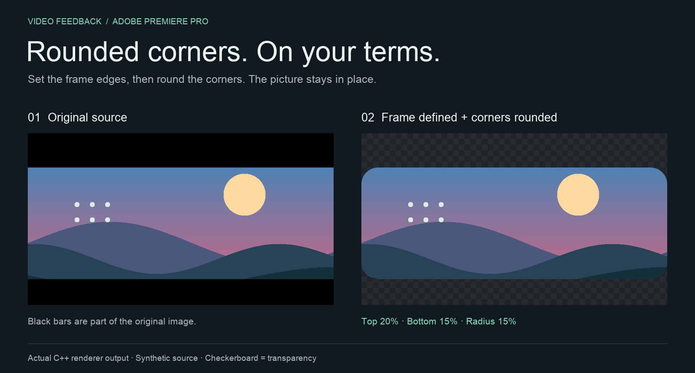
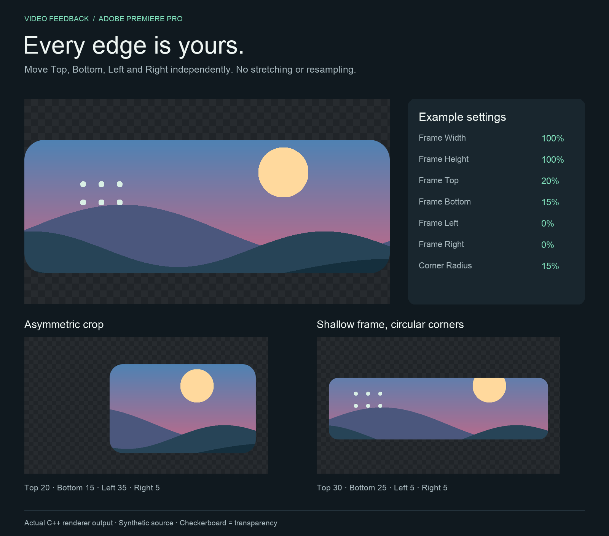
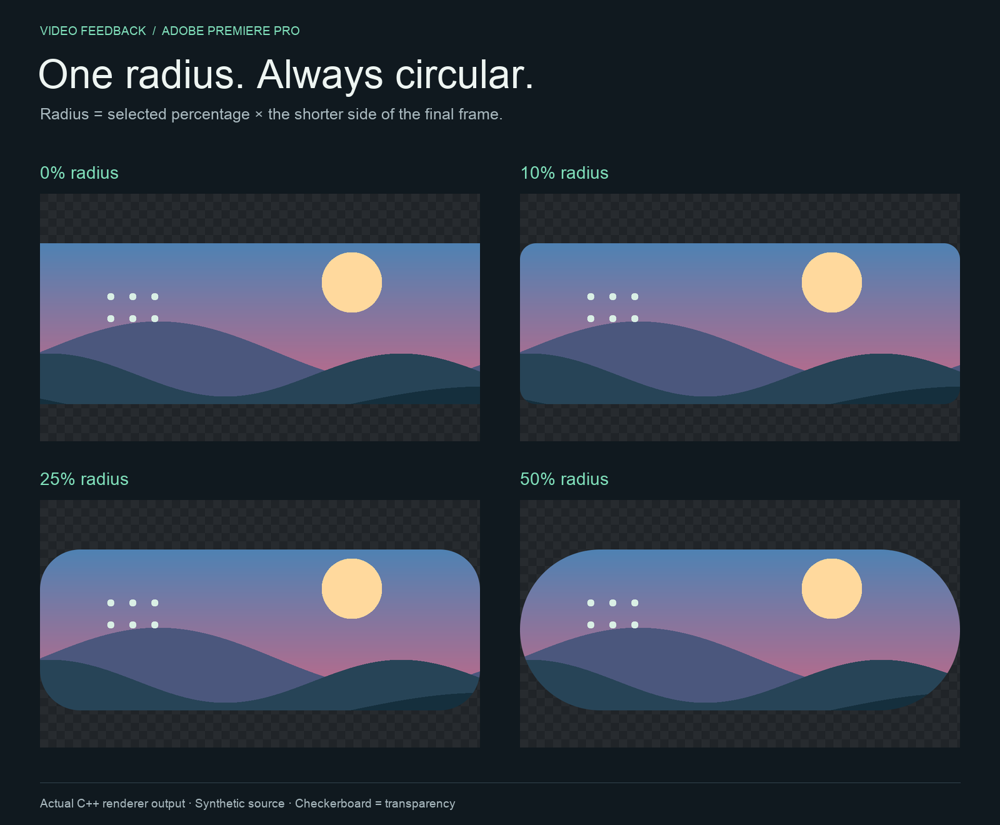

# Rounded Corners for Adobe Premiere Pro

A native macOS video effect that turns a clip or still image into a rounded frame.
Set each edge independently, remove baked-in black bars, and adjust circular corners
without stretching the picture.

**v0.3.0 prototype · macOS 12+ · Apple Silicon + Intel · 8-bit CPU processing**



*These are reproducible illustrations rendered by the plugin's actual C++ mask engine
using synthetic artwork. They are not screenshots of Premiere's interface.*

## What it does

- Independent **Top, Bottom, Left and Right** frame edges.
- **Width and Height** controls for a centered base frame.
- One **Corner Radius** measured from the shorter side of the final frame.
- Circular corners that remain circular when the frame changes aspect ratio.
- Antialiased transparency, preserving existing source alpha.
- Seven keyframeable controls; source pixels are cropped, never moved or resampled.

Black bars are not detected automatically. Set the edges to the visible content
boundary; the frame will then stay stable through dark scenes and fades.

## Visual examples



The settings card is a documentation reference, not a reproduction of Adobe's UI.
In the lower examples, Width and Height are both 100%, and Radius is 15%.



All four radius examples use the same source and frame: Top 20%, Bottom 15%,
Left/Right 0%, and Width/Height 100%. The checkerboard represents transparency.

## Build and install

This repository contains source code. Build the `.plugin` locally before installing.
The Adobe SDK and compiled binaries are not included.

### Requirements

- macOS 12 or later.
- Apple's Command Line Tools, including `clang++`, `Rez` and `codesign`.
- The [After Effects C++ SDK](https://developer.adobe.com/after-effects/), downloaded
  separately from Adobe. Its effect API also supports Premiere Pro.
- Premiere Pro to use the effect. The current build was developed with SDK 26.5.

Run these commands from the repository root, using your extracted SDK path:

```sh
bash scripts/test.sh
bash scripts/build-mac.sh "/path/to/AdobeAfterEffectsSDK_26.5_MacOS"
bash scripts/test-plugin.sh "/path/to/AdobeAfterEffectsSDK_26.5_MacOS"
bash scripts/install-mac.sh
```

The build is a universal Apple Silicon/Intel bundle with an ad-hoc signature for
local use. The installer copies it to your user account's Adobe plugin directory:

```text
~/Library/Application Support/Adobe/Common/Plug-ins/7.0/MediaCore/Rounded Corners.plugin
```

Previous installed builds are preserved in `build/install-backups/`. Adobe
applications are not restarted automatically. The installer does not require an
administrator password.

## Apply to a video clip

1. Save your project and **restart Premiere** after installation or an update.
2. Open **Window → Effects**, then search for **Rounded Corners** under
   **Video Effects → Video Feedback**.
3. Drag the effect onto a video or image clip in the timeline.
4. Select the clip and open **Effect Controls → Rounded Corners**.
5. Start with **Frame Width = 100%** and **Frame Height = 100%**.
6. Adjust the four frame edges to exclude black bars or define a custom crop.
7. Set **Corner Radius (% of frame)**; try **10%** as a starting point.

Put another clip on a lower video track to see through the corners. Without a
background, transparent areas may appear black in the monitor.

If an old effect instance still shows the retired Corner Width/Height controls,
remove that instance and apply Rounded Corners again after restarting.

## Controls

| Control | Default | What it changes |
| --- | --- | --- |
| Frame Width (%) | 100 | Centered base frame width relative to the input. |
| Frame Height (%) | 100 | Centered base frame height relative to the input. |
| Frame Top (%) | 0 | Additional top inset, as a percentage of input height. |
| Frame Bottom (%) | 0 | Additional bottom inset, as a percentage of input height. |
| Frame Left (%) | 0 | Additional left inset, as a percentage of input width. |
| Frame Right (%) | 0 | Additional right inset, as a percentage of input width. |
| Corner Radius (% of frame) | 10 | Circular radius, 0–50% of the shorter final frame side. |

Width/Height establish the centered rectangle first. The four edge controls then
trim it independently; their insets are additive to the centered trim. Use
Width/Height at 100% when you want to position all four edges directly. If opposite
edges meet or cross, the output becomes fully transparent.

### How the radius works

For a final frame of **800 × 400 display pixels** at **10%**, the radius is
**40 pixels in both directions**. The top-left arc center is
`(left + 40, top + 40)`, with equivalent inward offsets at the other corners.

Radius 0 gives square corners. Radius 50% produces a capsule, or a circle if the
frame is square. Pixel aspect ratio and preview resolution are compensated so the
corners remain circular in display space. Nonuniform scaling applied later in the
effect chain can still stretch the entire result.

## Status and limitations

This is an early development build, not a notarized commercial release.

- **8-bit ARGB CPU processing only.** Native 32-bit float/HDR and GPU acceleration
  are not implemented; this is not a high-bit-depth finishing effect yet.
- The C++ renderer and compiled Apple Silicon plugin pass automated tests.
- The Intel slice is compiled but has not been executed on Intel hardware.
- Premiere playback, keyframing and export compatibility have not been independently
  verified for this version. No claim of production validation is made.
- Interlaced footage and upstream effects that resize the input buffer need host tests.

See [development and verification](docs/DEVELOPMENT.md) for the test scope and
[change history](CHANGELOG.md) for previous versions.

## Uninstall

Quit Adobe applications, then move `Rounded Corners.plugin` out of the user
MediaCore folder shown above. Restart Premiere.

## Project layout

```text
src/          Native Adobe effect adapter and independent C++ mask engine
resources/    Adobe PiPL resource and macOS bundle metadata
scripts/      Build, test and installation commands
tests/        Geometry tests and compiled-plugin callback harness
tools/        Reproducible image generators
docs/images/  Rendered documentation examples
```

Adobe SDK files remain under their own terms and are not redistributed here.
Adobe and Premiere Pro are trademarks of Adobe. This is an independent project.
